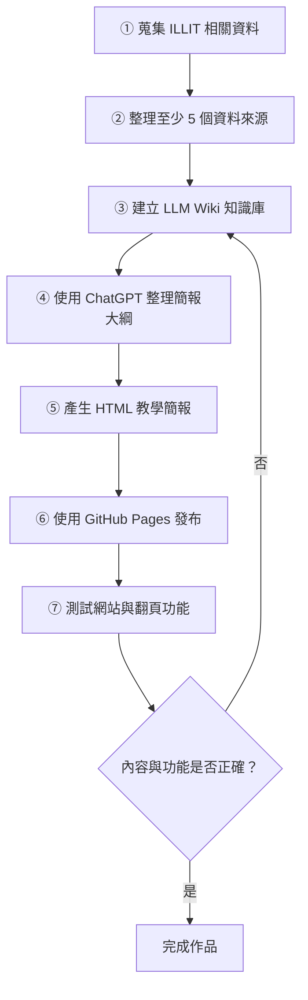

# ILLIT LLM Wiki 工作流程

## 一、專案製作流程

## 二、流程說明

1. 蒐集 ILLIT 的相關資料。
2. 將資料整理成 Wiki 文件。
3. 使用 ChatGPT 根據 Wiki 整理教學簡報大綱。
4. 製作 HTML 簡報。
5. 將檔案上傳到 GitHub。
6. 使用 GitHub Pages 發布網站。
7. 測試簡報的翻頁功能與內容。

## 三、檢查方式

- 確認 Wiki 文件是否存在。
- 確認簡報內容是否與 Wiki 一致。
- 確認網站能否正常開啟。
- 確認上一頁、下一頁按鈕能否正常操作。
